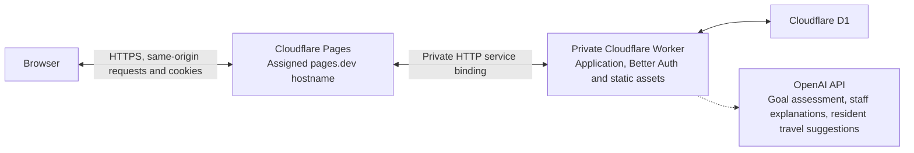

# BlockFit production architecture

Pages accepts the canonical project hostname and forwards every application path to the Worker through its service binding. The original Pages URL remains the request URL. Better Auth uses that same origin and issues host-only, secure session cookies. The Pages code forwards permitted application headers, normalizes same-origin redirects to the Pages hostname, and rejects unexpected redirect origins. The Worker also rejects requests addressed to any other hostname. Canonical aliases, cookies, and headers are covered by local Workerd and Better Auth tests.

The backend config disables the `workers.dev` route and Worker version preview URLs. The Pages ingress rejects Pages preview and deployment aliases; the canonical `pages.dev` hostname is the supported public endpoint. Both the public interface and the staff interface use this origin. Cloudflare Pages binds the Worker by its service name internally.

The Make workflow manages one Pages project, Worker and D1 database in the selected Cloudflare account. The protected manifest links their identities. Deploying updates the private Worker first, verifies its public routes are off, then publishes the Pages ingress. The D1 suspension switch blocks service via Pages while retaining data. Destruction removes Pages first and offers a separate D1 retention choice. [Pages service bindings](https://developers.cloudflare.com/pages/functions/bindings/#service-bindings) · [Workers routing](https://developers.cloudflare.com/workers/configuration/routing/workers-dev/)

## Equipment catalog and proposal review

D1 owns equipment type IDs and their current labels. Equipment, candidates, resident demand, and synthetic demand reference those IDs. Active type selection is validated where records are written. Public inventory can still display installed equipment associated with inactive types. Catalog mutations increment the comparison revision, which also invalidates the existing AI caches.

A proposal holds the owner, submitted name and description, and the pending request intent with its own location and optional suggested installation site. The staff queue receives only review fields. Approval uses one D1 batch to create a type when necessary, create or find the resident’s ordinary request, and record the decision. The existing partial unique index enforces one recorded request per owner and type. Pending intents remain outside the demand table. After any decision or withdrawal, the proposal keeps its review history and clears the copy of the private intent. [D1 batch transactions](https://developers.cloudflare.com/d1/worker-api/d1-database/#batch)

## Program goals

D1 stores shared, versioned goals with stable catalog IDs. The selected goal, filters, and order belong to the current staff view. Candidate records have optional date-only estimates. The comparison computes requirements and eligibility for each site and combination. The AI gateway sends qualitative assessment data with precomputed coverage and cost figures, then validates the complete option set and evidence references. Staff evaluation and Explain share the reservation and spending ledger. The gateway checks the comparison and goal version at reservation and settlement. Cached evaluations are reused across filters, and explanations are keyed to the exact view. [OpenAI Structured Outputs](https://developers.openai.com/api/docs/guides/structured-outputs)
