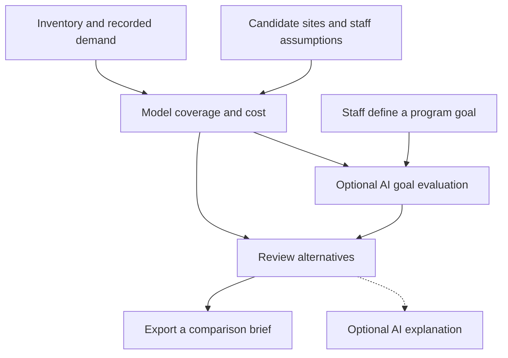

# Comparing outdoor recreation investments

Suppose a parks team has a fixed budget for outdoor pull-up equipment. BlockFit helps it compare what individual sites and small combinations could add under common assumptions. The Brooklyn and Queens beta uses illustrative site and cost data. Teams can examine how changing the assumptions affects the comparison before deciding what to investigate further.

## Inspect demand and assumptions

Choose an equipment type and review the inventory, demand origins, and candidate sites. The comparison distinguishes recorded resident requests from synthetic demo demand. A request is a signal from someone who chose to participate. Validate patterns against other community input and local data before drawing conclusions about population-wide need.

Set the straight-line coverage radius, upfront budget and planning horizon. Baseline coverage comes from listed, verified, usable equipment with confirmed public access. The model estimates how many previously uncovered requesters fall within the selected radius of candidate sites. When two sites cover the same requester, the combination counts that person once. A radius on the map is a geographic approximation. Staff still need to check walking routes, crossings, ownership, and physical suitability.

Compare modeled low, base, and high costs. The app displays upfront budget fit, undiscounted lifecycle cost, and cost per newly covered requester. Unknown costs stay unknown. The baseline highlight uses base lifecycle cost per newly covered requester among fully costed, suitable options with positive coverage and base upfront costs within budget.

## Apply a program goal

Choose a saved goal or create one with a short name, a description, and optional eligible equipment types, earliest start, and target completion dates. For example, a low-disruption program might prioritize an existing paved area if site notes support it. A delivery-readiness goal might look for a recorded schedule that meets a target date. Missing estimates remain unknown. Notes or schedules in the app do not establish accessibility certification, demographic suitability, or a confirmed delivery date.

BlockFit applies structured equipment and date requirements and checks budget and feasibility separately. An optional AI evaluation compares the written objective with available evidence and describes the qualitative fit as **Strong**, **Partial**, **Weak**, or **Insufficient evidence**. The assessment can call out tradeoffs or missing information. Staff verify the evidence and retain responsibility for decisions about suitability and policy compliance.

## Review alternatives and share results

The ordinary comparison works without a goal or an AI explanation. When an AI goal evaluation returns assessments, staff can sort by goal fit or keep the ordinary order. Use the fit filters to inspect matching, excluded, or uncertain options. Open a row’s evidence hint to see failed checks, reasons, or missing information. An optional AI explanation describes the tradeoffs for the current view and how the selected goal affects it.

**Download brief** exports a Markdown file with the equipment type, assumptions, comparison revision, coverage counts, site and cost details, and any applicable goal context and cached explanation. The brief omits private request locations and resident identities.

## Where the results could help

These handoffs illustrate how an analyst could use the results in existing municipal processes.

| Municipal activity | BlockFit contribution | Manual handoff |
| --- | --- | --- |
| Community needs assessment | Identify clusters of recorded equipment requests and compare them with existing coverage. | Review with outreach, surveys, and other district evidence while preparing [Statements of Community District Needs](https://www.nyc.gov/site/communityboards/mandates/district-needs.page). |
| Candidate and project screening | Compare preliminary coverage and cost for alternative sites under the same assumptions. | Confirm ownership, access, scope, and feasibility with the responsible teams. Bring viable options into the [community board budget request process](https://www.nyc.gov/assets/planning/download/pdf/planning-level/community-district-needs/2022-cd-needs-overview-handout_web.pdf). |
| Capital planning discussions | Carry a comparison brief into discussions about scope, budget fit, lifecycle costs, and program goals. | Use the municipality’s own review, budgeting and approval process. See the [NYC Council overview of the City budget](https://council.nyc.gov/budget/). |

A pilot could test local data and assumptions with staff, compare candidate choices under the same budget, and examine changing coverage and goal alignment while accounting for participation bias. Modeled coverage per cost measures a scenario. Realized savings, economic returns, health outcomes and broad public benefits would need separate evidence. Responsible officials retain ownership of feasibility, procurement, approvals, and delivery.

[Back to BlockFit](../README.md) · [Resident workflow](resident-workflow.md)
