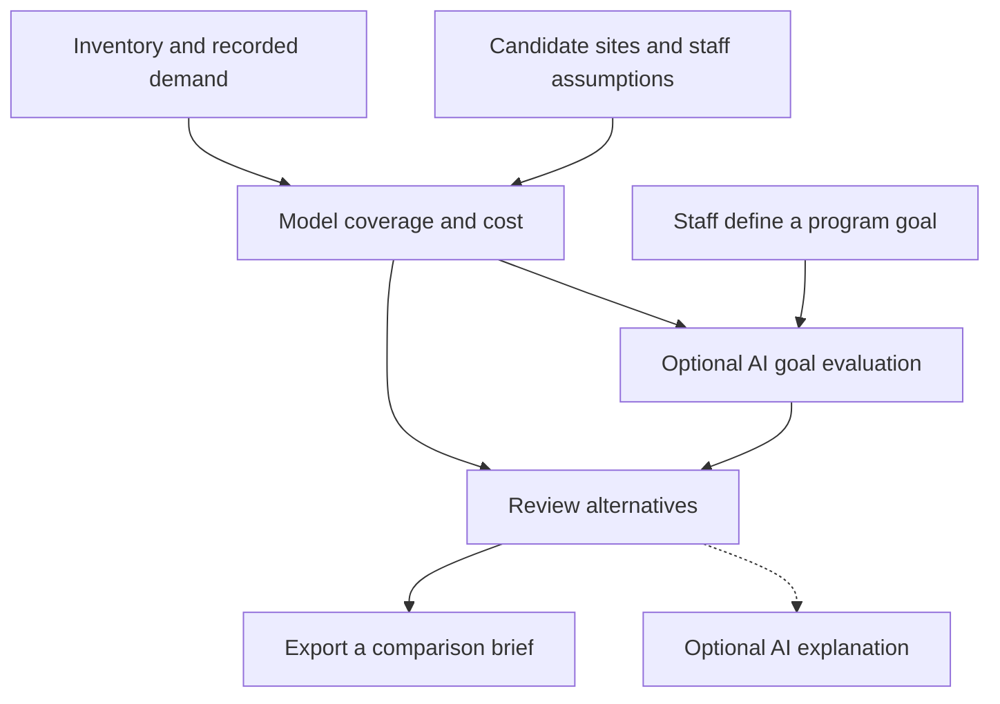
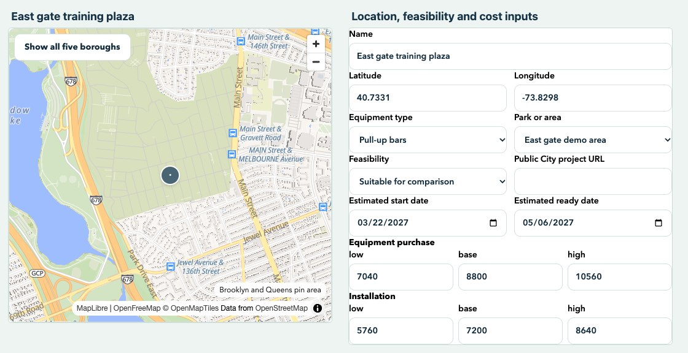
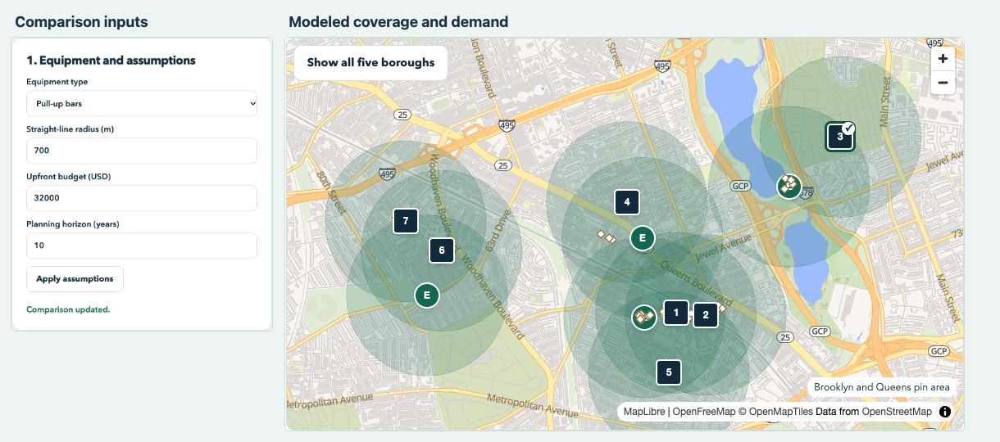
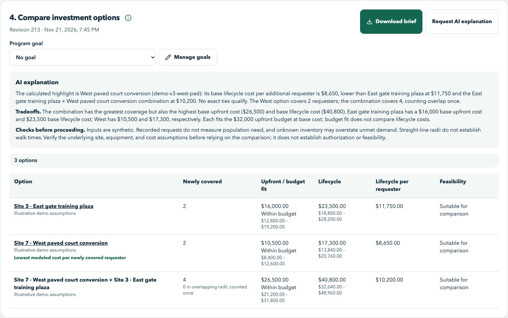
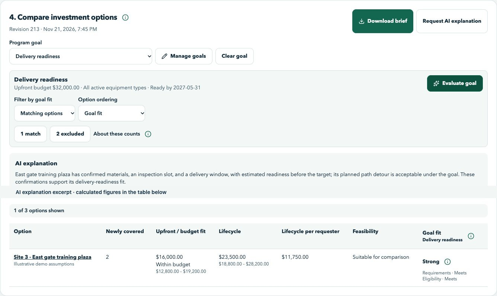
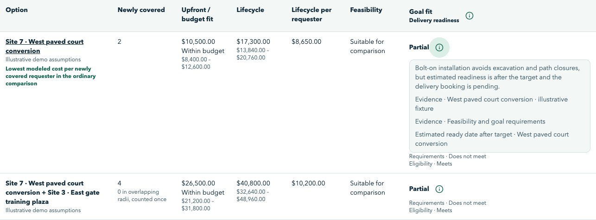

# Comparing outdoor recreation investments

Suppose a parks team has a fixed budget for outdoor pull-up equipment. BlockFit helps it compare what individual sites and small combinations could add under common assumptions. The Brooklyn and Queens beta uses illustrative site and cost data. Teams can examine how changing the assumptions affects the comparison before deciding what to investigate further.

## Define candidate sites

A candidate site is a possible investment location that staff enter for evaluation. Staff might identify one through a site assessment, a community proposal, existing property information, or project planning. Public property and capital project records can provide context. Ownership, site suitability, and project approval need separate verification. [NYC Parks Properties](https://data.cityofnewyork.us/Recreation/Parks-Properties/enfh-gkve) · [NYC Capital Projects Portal](https://capitalprojects.nycplanningdigital.com/about)

*Illustrative demo data. The editor records what the team is proposing and the assumptions it will compare. “Suitable for comparison” is a screening status.*

## Inspect demand and assumptions

Choose an equipment type and review the inventory, demand origins, and candidate sites. The map distinguishes recorded resident requests from synthetic demo demand. A request is a signal from someone who chose to participate. Validate patterns against other community input and local data before drawing conclusions about population-wide need.

Set the straight-line coverage radius, upfront budget and planning horizon. Baseline coverage comes from listed, verified, usable equipment with confirmed public access. BlockFit estimates how many previously uncovered requesters fall within reach of each option, counting each requester once in a combination. Staff can check actual walking routes, crossings, and barriers separately.

*Illustrative demo data. The example uses a 700 m straight-line radius to show catchments around candidate sites and eligible equipment. Treat it as a scenario assumption. Walking access and municipal standards require separate review.*

## Compare alternatives

### Calculation-based comparison with AI explanation

BlockFit calculates coverage, low/base/high costs, upfront budget fit, undiscounted lifecycle cost, and cost per newly covered requester. Unknown costs stay unknown. The baseline highlight uses base lifecycle cost per newly covered requester among fully costed, suitable options with positive coverage and base upfront costs within budget. Staff can optionally ask AI to explain the results and tradeoffs.

*Illustrative demo data. A $32,000 budget, 700 m radius, and 10-year horizon produce three options from two candidate sites. The calculation highlights West paved court at $8,650 in modeled lifecycle cost per newly covered requester. The explanation interprets those results.*

### Goal-based comparison with AI explanation

Choose or create a goal with a description and optional eligible equipment types, earliest start, and target completion. BlockFit applies the structured requirements and evaluates budget and feasibility separately. AI can assess the written objective as **Strong**, **Partial**, **Weak**, or **Insufficient evidence**, using the available inputs. Staff can sort by goal fit, retain the ordinary order, or filter the options for review.

*Illustrative demo data. With the same sites, costs, budget and radius, the Delivery readiness goal adds a May 31 target. East gate remains in Matching options. West paved court and the paired option miss the target. The underlying coverage and cost calculations carry through. The screenshot shows an excerpt of the AI explanation. Use the table to verify figures.*

## Inspect an assessment and share results

Switch to **Excluded options** or **Needs information** to see alternatives and open a row’s evidence hint. A missing schedule stays unknown, and staff can inspect AI reasoning beside the app’s structured checks. Accessibility, demographic suitability, and delivery dates need appropriate supporting evidence.

*Illustrative demo data. West paved court’s row shows the missed completion target alongside the AI assessment. Staff can see why the option was excluded and identify what to verify.*

**Download brief** exports a Markdown file with the equipment type, assumptions, comparison revision, coverage counts, site and cost details, and any applicable goal context and cached explanation. The brief omits private request locations and resident identities.

The Center for an Urban Future’s March 2026 report found 27 public athletic facilities in Bronx Community District 5, equivalent to one facility for every 4,930 residents. The uneven distribution described in the report illustrates why planners benefit from comparing access across locations. Evidence about BlockFit’s effectiveness would require a separate evaluation. [Putting the “Rec” Back in NYC Parks & Recreation](https://nycfuture.org/research/putting-the-rec-back-in-nyc-parks-recreation)

## Where the results could help

These handoffs illustrate how an analyst could use the results in existing municipal processes.

| Municipal activity | BlockFit contribution | Manual handoff |
| --- | --- | --- |
| Community needs assessment | Identify clusters of recorded equipment requests and compare them with existing coverage. | Review with outreach, surveys, and other district evidence while preparing [Statements of Community District Needs](https://www.nyc.gov/site/communityboards/mandates/district-needs.page). |
| Candidate and project screening | Compare preliminary coverage and cost for alternative sites under the same assumptions. | Confirm ownership, access, scope, and feasibility with the responsible teams. See the [FY 2027 Adopted Register of Community Board Budget Requests](https://www.nyc.gov/assets/omb/downloads/pdf/adopt26/cbrboro6-26.pdf) for the City’s process. |
| Capital planning discussions | Carry a comparison brief into discussions about scope, budget fit, lifecycle costs, and program goals. | Use the municipality’s own review, budgeting and approval process. See the [NYC Council overview of the City budget](https://council.nyc.gov/budget/). |

A pilot could test local data and assumptions with staff, compare candidate choices under the same budget, and examine changing coverage and goal alignment while accounting for participation bias. Modeled coverage per cost measures a scenario. Realized savings, economic returns, health outcomes and broad public benefits would need separate evidence. Responsible officials retain ownership of feasibility, procurement, approvals, and delivery.

[Back to BlockFit](../README.md) · [Resident workflow](resident-workflow.md)
