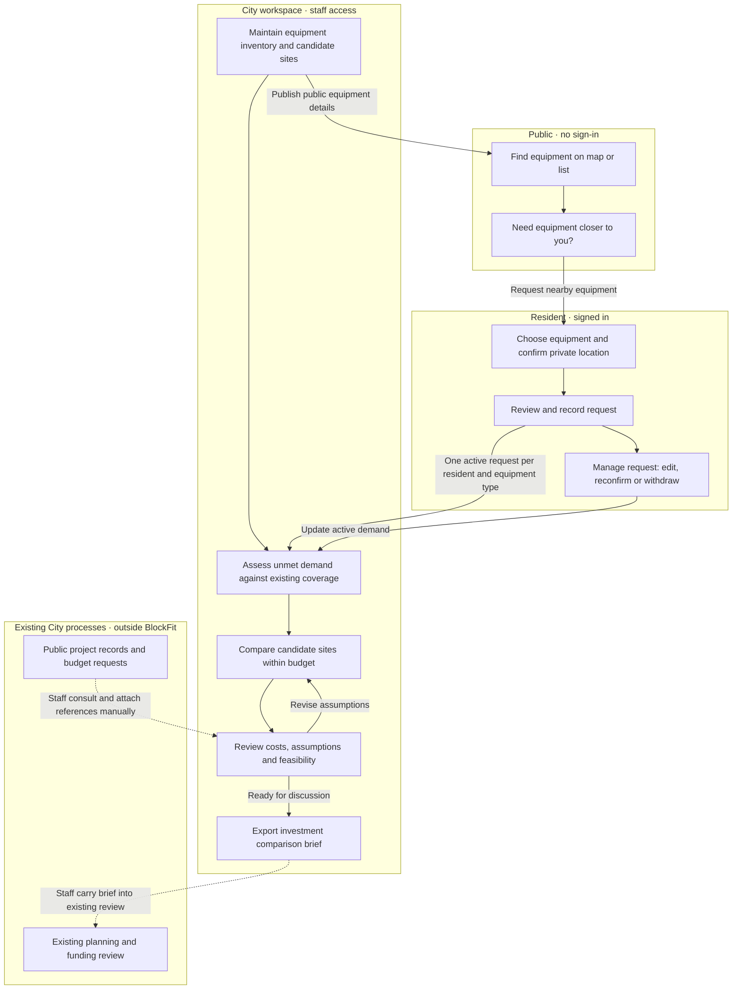

# BlockFit NYC — MVP Process

**NYCEDC project concept · 17 November 2026**

Turn equipment-specific resident demand into an investment comparison that staff can use within existing City planning and funding reviews.

## Process diagram

**Solid arrows:** intended flow within the working MVP. **Dashed arrows:** manual use of external public records and existing City review processes; no system integration or automatic submission.

## Essential operating rules

- **Public access:** Equipment search and public details remain available without login. Resident locations and individual requests are private. Only public equipment information flows from the staff inventory to the public map; candidate sites are separate planning records.
- **Resident demand:** One saved location and one active request per equipment type. Edits and reconfirmations update the same record; withdrawal removes it from active demand. An optional installation-site suggestion does not replace the request origin or establish site suitability. “Recorded” does not mean accepted, funded or reviewed by a City agency.
- **Coverage:** Apply a shared, configurable straight-line distance threshold, explicitly labeled as an approximation. Count distinct active requesters who lack existing equipment coverage and gain coverage under a candidate option. Count overlap once when comparing a combination of sites. Requests are a participation sample, not a population-wide measure of need.
- **Investment comparison:** Show upfront budget fit, additional requesters covered, installation and site costs, maintenance and replacement over a common planning period, and modeled cost per newly covered requester. Keep assumptions, ranges, missing costs and feasibility visible. Staff retain decision authority; the output does not establish realized savings or approval.
- **AI assistance:** Staff may request a cached explanation of calculated results and missing assumptions. Deterministic code performs the calculations. The comparison remains usable without AI; AI does not invent costs or approve investments.
- **External handoff:** Staff consult public City records, record relevant references and export a brief for an existing review. Broken park-equipment reports link to NYC311 outside this investment flow. BlockFit does not submit them.

## MVP demonstration boundary

Demonstrate one neighborhood, three equipment categories and two candidate sites. Use clearly labeled synthetic demand and illustrative costs, with public or manually entered equipment records and verification status. The working MVP must connect recorded, edited and withdrawn requests to staff comparisons. The existing HTML wireframes demonstrate these interfaces separately; they do not yet share a database or implement authentication.

## Public workflow references

- [NYCEDC — QueensWay Metropolitan Hub](https://edc.nyc/project/queensway-metropolitan-hub): public community-engagement and project materials.
- [NYC Capital Projects Portal — About](https://capitalprojects.nycplanningdigital.com/about): community-board budget requests, agency responses and dataset limitations.
- [NYC311 — Park Maintenance Complaint](https://portal.311.nyc.gov/article/?kanumber=KA-01060): existing official maintenance-reporting channel.

These references establish relevant existing workflows, not an agency partnership or integration commitment. This process document complements the MVP blueprint and three interface wireframes; it adds no new feature scope.
