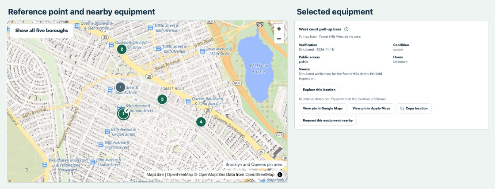
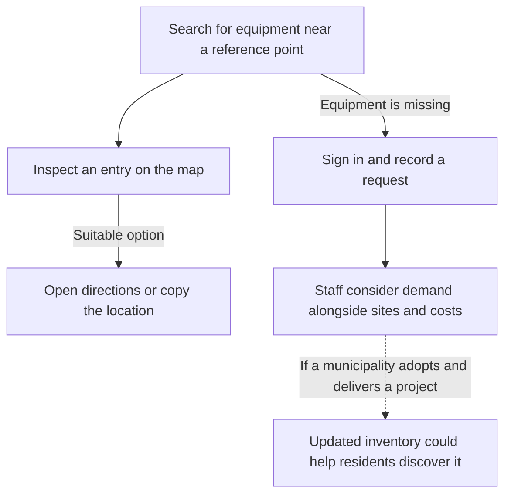
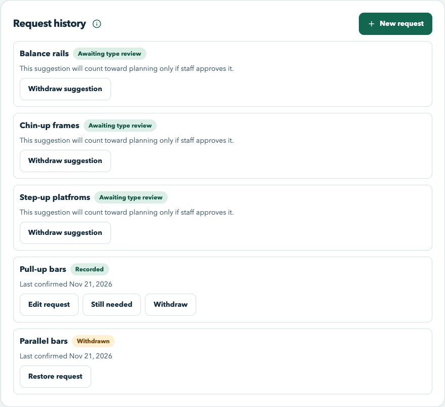

# Finding and requesting equipment

Imagine you want to find a pull-up bar near a park you visit. Open the public equipment map, choose **Pull-up bars**, and set a reference location. The list and map show equipment entries that match the selected type. Select an entry to see the details on file, including condition, access, and verification where available. The Brooklyn and Queens beta includes illustrative listings with simulated verification. Treat those entries as examples before planning a visit.

*Illustrative demo data. The reference pin sets the starting point for distance comparisons. The selected listing shows the available verification and access details before you open directions.*

[Try the public beta](https://blockfit-demo.pages.dev/)

## Decide where to go

Compare nearby entries by their straight-line distance from your reference point. Open an entry in Google Maps or Apple Maps for directions, or copy the location. The external map handles routing. This discovery flow is useful even if you never create an account or submit a request.

If you sign in as a resident, you can ask the AI travel helper for a shortlist or an explanation about a selected site. It can use equipment information and available map landmarks to help you compare choices. Check the listing and directions before heading out, particularly when accessibility, opening hours, or the condition of the equipment matter.

## Record a missing option

In the beta service area, a signed-in resident can save a private location and choose whether to use it for new requests. Select the equipment type and review the request before recording it. You can suggest a different installation site separately. If the equipment type is missing from the catalog, submit a type suggestion for staff review. If staff approve it, the app records the associated demand or links it to an active request.

In **My requests**, a **Recorded** status means the request is saved. You can update an active request, confirm that you still need the equipment, or withdraw it. To restore a withdrawn request, its equipment type must be active and you need a saved location enabled for requests. Type suggestions have their own review status in the request history.

*Illustrative demo records. A saved request offers Edit request, Still needed, and Withdraw. A withdrawn request stays visible with a Restore request action. A type suggestion awaiting review is listed separately.*

## How it informs planning

A recorded request contributes a location and equipment type to staff planning. Searching or opening directions contributes no request. Staff use recorded demand alongside inventory, costs, and candidate sites. BlockFit is an independent beta. It does not submit requests to a City agency, and recording a request does not guarantee a project.

If a municipality eventually approves and delivers an investment through its own process, updated inventory could help residents discover what was installed.

[Back to BlockFit](../README.md) · [Government planning workflow](government-planning-workflow.md)
